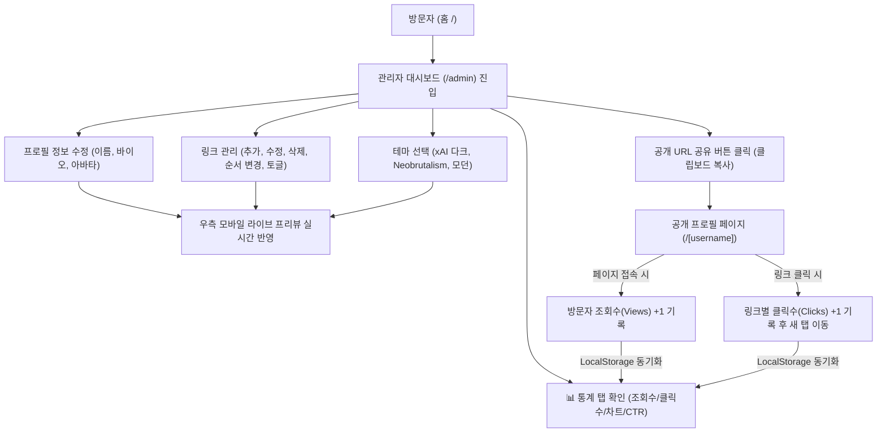
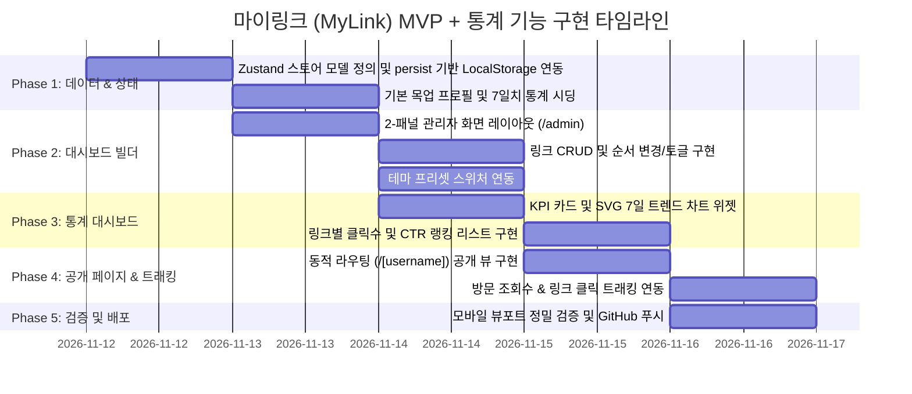

# [PRD] 링크트리 클론 서비스: 마이링크 (MyLink)

> **버전**: v1.1.0 (MVP + Analytics)  
> **작성일**: 2026-11-12  
> **상태**: 승인 및 구현 준비 완료  
> **작성 대상**: 프론트엔드 엔지니어링 및 프로토타입 구현팀  

---

## 1. Executive Summary (개요)

### 1.1 프로젝트 정의
**마이링크(MyLink)**는 크리에이터, 개발자, 인플루언서가 자신의 모든 소셜 채널과 포트폴리오, 프로젝트 링크를 단 하나의 URL(`/[username]`)로 통합하여 공유하고, 방문자의 유입 및 클릭 성과를 한눈에 분석할 수 있는 **링크트리(Linktree) 스타일의 다중 사용자 마이크로 프로필 SaaS 서비스**입니다.

### 1.2 개발 전략 및 MVP 범위
- **빠른 프로토타이핑을 위한 Mock 기반 아키텍처**:
  - 초기 단계에서는 외부 DB/인증 인프라 연동 비용을 최소화하기 위해 **Mock 데이터 + LocalStorage** 기반으로 동작하는 고도화된 프론트엔드 완결형 프로토타입을 구축합니다.
- **실시간 2-패널 빌더 UI**:
  - 링크트리의 시그니처 경험인 **좌측 에디터(편집 패널) + 우측 스마트폰 라이브 미리보기(Live Preview)**를 구현합니다.
- **테마 프리셋 시스템**:
  - xAI 미니멀 다크, 네오브루탈리즘, 클래식 모던 등 검증된 디자인 프리셋을 원클릭으로 전환할 수 있습니다.
- **내장 통계 및 애널리틱스 엔진 (Analytics & Telemetry)**:
  - 프로필 조회수(Views), 링크별 클릭수(Clicks), 전환율(CTR), 최근 7일간 추이 차트를 제공하여 사용자가 자신의 링크 성과를 즉각 확인할 수 있습니다.

---

## 2. Target Audience & Core Value (타깃 및 핵심 가치)

### 2.1 타깃 사용자
1. **개발자 & 테크 크리에이터**: GitHub, 기술 블로그, 포트폴리오를 세련되게 공유하고 어떤 프로젝트가 가장 많은 관심을 받는지 측정하고 싶은 사용자
2. **대학생 & 취업 준비생**: 개인 이력, 링크드인, 프로젝트 저장소를 하나의 이력서 링크로 전달하고 채용 담당자의 링크 열람 여부를 확인하고 싶은 사용자
3. **일반 크리에이터**: 인스타그램, 유튜브 등의 바이오 링크로 다채로운 테마의 링크 모음을 운영하며 유입 성과를 최적화하고 싶은 사용자

### 2.2 핵심 가치 (Value Proposition)
- **Zero-Friction Link Management**: 몇 초 만에 링크를 추가, 순서 변경, On/Off 토글 가능
- **Visual Identity**: 단순 텍스트 나열을 넘어 개성 있는 디자인 테마(xAI, Neobrutalism 등) 적용
- **Live Sync Preview**: 수정한 내용이 스마트폰 화면에서 어떻게 보일지 실시간으로 확인
- **Actionable Insights (통계 기능)**: 어떤 링크가 인기가 많은지(클릭률, 순위) 직관적인 대시보드로 확인하여 링크 배치 최적화 가능

---

## 3. Information Architecture & User Flow (구조 및 흐름)

### 3.1 사이트맵 (Sitemap)
```text
/ (루트)                 # 서비스 소개 랜딩 페이지 및 데모 체험 진입
├── /admin (대시보드)     # 링크트리형 관리자 2-패널 빌더
│   ├── [탭] 프로필 설정  # 이름, 바이오, 핸들명, 아바타 수정
│   ├── [탭] 링크 관리   # 링크 CRUD, 순서 변경, 온/오프 토글
│   ├── [탭] 테마 선택   # xAI / Neobrutalism / Modern 프리셋 스위처
│   └── [탭] 통계 분석   # 조회수, 클릭수, CTR, 7일 추이 차트, 링크별 랭킹
└── /[username] (공개)   # 방문자용 최종 반응형 공개 프로필 링크 페이지 (예: /kimqyoung)
```

### 3.2 핵심 유저 플로우 (User Journey)


---

## 4. Functional Requirements (기능 상세 정의서)

### 4.1 [FR-1] 프로필 및 계정 기본 설정
| ID | 기능명 | 설명 | 우선순위 |
|---|---|---|:---:|
| FR-1.1 | 사용자 프로필 정보 수정 | 이름(Name), 한 줄 소개(Bio), 핸들명(Username) 수정 기능 | P0 |
| FR-1.2 | 프로필 아바타 이미지 선택 | 기본 제공 아바타 프리셋 또는 이미지 URL 직접 입력 지원 | P0 |
| FR-1.3 | 계정 프로필 저장 | 변경된 프로필 데이터를 LocalStorage에 실시간 자동 저장 | P0 |

### 4.2 [FR-2] 링크 관리 (Link Management Engine)
| ID | 기능명 | 설명 | 우선순위 |
|---|---|---|:---:|
| FR-2.1 | 링크 추가 (Create) | URL, 타이틀(제목), 부가 설명(선택)을 입력하여 새 링크 카드 생성 | P0 |
| FR-2.2 | 링크 인라인 수정 (Update) | 등록된 링크의 텍스트, URL을 대시보드 리스트에서 바로 수정 | P0 |
| FR-2.3 | 링크 삭제 (Delete) | 특정 링크를 목록에서 영구 제거 | P0 |
| FR-2.4 | 링크 활성화 토글 (Visibility) | 공개 페이지에 해당 링크를 노출할지 여부를 Switch/Toggle로 제어 | P0 |
| FR-2.5 | 순서 변경 (Reorder) | 링크 카드를 위/아래 버튼(또는 드래그 앤 드롭)으로 순서 재배치 | P0 |

### 4.3 [FR-3] 관리자 대시보드 (Admin 2-Panel Builder)
| ID | 기능명 | 설명 | 우선순위 |
|---|---|---|:---:|
| FR-3.1 | 좌측 에디터 패널 | 프로필 탭, 링크 목록 탭, 테마 설정 탭, **통계(Analytics) 탭**으로 구성된 직관적인 조작 패널 | P0 |
| FR-3.2 | 우측 모바일 폰 프리뷰 | 실제 스마트폰 디바이스 프레임 안에 실시간 렌더링되는 라이브 프리뷰 | P0 |
| FR-3.3 | 반응형 레이아웃 전환 | 데스크톱에서는 2-패널로 나란히 표시, 모바일/태블릿에서는 탭 전환식(에디터/미리보기)으로 제공 | P1 |
| FR-3.4 | 공유 링크 원클릭 복사 | `/[username]` 공개 URL을 즉시 클립보드에 복사하는 헤더 액션 버튼 | P0 |

### 4.4 [FR-4] 테마 프리셋 엔진 (Theme Preset Engine)
| ID | 테마명 | 디자인 언어 및 스타일 규격 | 우선순위 |
|---|---|---|:---:|
| FR-4.1 | **xAI Minimal Dark** | • `#0a0a0a` 단일 다크 캔버스<br>• `Weight 400` 기하학적 폰트 & 음수 자간<br>• 대문자 `GeistMono` 주석 스타일 라벨<br>• 1px 헤어라인 보더 & 화이트 아웃라인 필 버튼 (그림자 없음) | P0 |
| FR-4.2 | **Neobrutalism Retro** | • 모눈종이 그리드 캔버스 (`#F4F0EA`)<br>• 굵은 3~4px 블랙 솔리드 테두리<br>• 비비드 팝 컬러 & 8px 하드 오프셋 그림자<br>• 레트로 OS 윈도우 타이틀바 & 스티커 배지 | P0 |
| FR-4.3 | **Modern Clean Light** | • 소프트 화이트/그레이 캔버스 (`#FFFFFF` ~ `#F8FAFC`)<br>• 은은한 섀도우(Elevated Blur Shadow)와 부드러운 라운드(16px)<br>• 차분한 인디고 포인트 컬러 | P1 |

### 4.5 [FR-5] 방문자용 공개 프로필 페이지 (`/[username]`)
| ID | 기능명 | 설명 | 우선순위 |
|---|---|---|:---:|
| FR-5.1 | 동적 라우팅 지원 | Next.js App Router의 Dynamic Route(`/[username]`)를 통해 각 사용자 링크 렌더링 | P0 |
| FR-5.2 | 테마 동적 렌더링 | 저장된 사용자의 선택 테마 스킨을 그대로 적용하여 풀스크린 렌더링 | P0 |
| FR-5.3 | 링크 클릭 인터랙션 | 클릭 이벤트 로깅 후 새 탭(`target="_blank"`)으로 외부 URL 이동 지원 | P0 |
| FR-5.4 | 이메일 클립보드 복사 | 이메일 항목 클릭 시 주소 복사 및 테마별 맞춤 토스트 알림 노출 | P0 |
| FR-5.5 | 반응형 최적화 | 300px 초소형 모바일 기기부터 4K 모니터까지 글자 겹침이나 깨짐 없는 반응형 레이아웃 | P0 |

### 4.6 [FR-6] 통계 및 애널리틱스 (Analytics & Telemetry Engine)
| ID | 기능명 | 세부 명세 및 요구사항 | 우선순위 |
|---|---|---|:---:|
| FR-6.1 | 핵심 KPI 요약 카드 | • **누적 프로필 조회수(Total Views)**: 공개 프로필 방문 횟수 집계<br>• **누적 링크 클릭수(Total Clicks)**: 모든 링크의 총 클릭 수 합계<br>• **평균 클릭률(Average CTR)**: (총 클릭수 / 총 조회수) × 100% 계산 표시<br>• **활성 링크 수(Active Links)**: 현재 노출 중인 링크 개수 | P0 |
| FR-6.2 | 최근 7일 추이 차트 | • 일별 방문자 수(Views)와 링크 클릭 수(Clicks) 추이를 보여주는 인터랙티브 막대/라인 차트<br>• 경량 SVG 기반 렌더링 (외부 대형 차트 라이브러리 없이 순수 Tailwind/SVG로 고속 로딩 보장) | P0 |
| FR-6.3 | 링크별 성과 랭킹 테이블 | • 등록된 각 링크별 **클릭 수(Clicks)** 및 **개별 CTR(%)** 표기<br>• 클릭 수가 높은 순서대로 Top Performing 링크 정렬 표시<br>• 링크별 시각적 게이지 바(Click Share Bar) 제공 | P0 |
| FR-6.4 | 실시간 이벤트 트래킹 | • 공개 프로필(`/[username]`) 로드시 `Views` 자동 +1 (세션 중복 방지 로직 포함)<br>• 링크 버튼 클릭 시 해당 링크의 `clicks` 필드 +1 카운트 및 당일 통계에 반영<br>• LocalStorage에 실시간 반영되어 관리자 대시보드에서 새로고침 없이 즉시 확인 가능 | P0 |
| FR-6.5 | 통계 데이터 초기화 및 Mock 시딩 | • 통계 지표가 비어 있을 때 보기 좋은 7일치 데모 데이터 자동 시딩 기능<br>• 사용자가 원할 경우 클릭 카운터를 0으로 초기화할 수 있는 '통계 리셋' 액션 | P1 |

---

## 5. Technical Architecture & Data Model (기술 설계 및 데이터)

### 5.1 기술 스택
- **Framework**: Next.js 16 (App Router)
- **Language**: TypeScript 5
- **Styling**: Tailwind CSS v3 (안정성 및 고성능 보장)
- **State Management**: **Zustand v5** (초경량 반응형 상태 관리, `persist` 미들웨어 기반 `localStorage` 자동 영속화 및 2-패널 선택자 최적화)
- **Icons**: Lucide Icons / Custom SVG Icons
- **Data Visualization**: Pure Tailwind CSS + SVG Charts (별도 무거운 차트 패키지 없이 0ms 로딩)

### 5.2 핵심 데이터 스키마 및 Zustand 스토어 (TypeScript Types)
```typescript
export type ThemeId = "xai" | "neobrutalism" | "modern";

export interface LinkItem {
  id: string;
  title: string;
  url: string;
  description?: string;
  icon?: string;
  isActive: boolean;
  order: number;
  clicks: number;          // 링크별 누적 클릭수
}

export interface DailyStat {
  date: string;            // 'YYYY-MM-DD' 형식
  views: number;           // 해당 일자 프로필 조회수
  clicks: number;          // 해당 일자 링크 클릭수
}

export interface AnalyticsSummary {
  totalViews: number;      // 누적 프로필 조회수
  totalClicks: number;     // 누적 링크 클릭 총합
  dailyHistory: DailyStat[]; // 최근 7~14일간 일별 통계
}

export interface UserProfile {
  username: string;        // 고유 핸들 (예: "kimqyoung")
  name: string;            // 표시 이름 (예: "김규영")
  bio: string;             // 소개글
  avatarUrl: string;       // 아바타 이미지 경로
  email: string;           // 연락처 이메일
  theme: ThemeId;          // 선택된 테마 프리셋
  links: LinkItem[];       // 관리 중인 링크 목록
  analytics: AnalyticsSummary; // 통계 및 애널리틱스 데이터
}

// Zustand 전역 상태 및 액션 인터페이스
export interface MyLinkState {
  profile: UserProfile;
  // 프로필 & 테마 액션
  updateProfile: (data: Partial<Pick<UserProfile, "name" | "bio" | "avatarUrl" | "email">>) => void;
  setTheme: (theme: ThemeId) => void;
  // 링크 CRUD 및 정렬 액션
  addLink: (link: Omit<LinkItem, "id" | "order" | "clicks">) => void;
  updateLink: (id: string, data: Partial<Omit<LinkItem, "id">>) => void;
  deleteLink: (id: string) => void;
  toggleLinkActive: (id: string) => void;
  reorderLinks: (sourceIndex: number, destinationIndex: number) => void;
  // 애널리틱스 트래킹 액션
  recordPageView: () => void;
  recordLinkClick: (linkId: string) => void;
  resetAnalytics: () => void;
}
```

---

## 6. Implementation Roadmap & Milestones (구현 마일스톤)



---

## 7. Success Metrics (성공 지표)
1. **사용성**: 대시보드에서 링크를 추가하고 저장했을 때 0.1초 이내에 라이브 프리뷰에 즉시 반영되는가?
2. **테마 일관성**: xAI, Neobrutalism 테마 전환 시 디자인 가이드라인의 규격을 오차 없이 표현하는가?
3. **통계 정확도 및 실시간성**: 공개 페이지 방문 및 링크 클릭 시 0ms 지연으로 카운트가 기록되고 대시보드 차트에 오차 없이 반영되는가?
4. **반응형 안정성**: 모바일 300px~375px 및 데스크톱에서 모든 텍스트, 버튼, 통계 위젯이 깨짐 없이 완벽하게 동작하는가?
